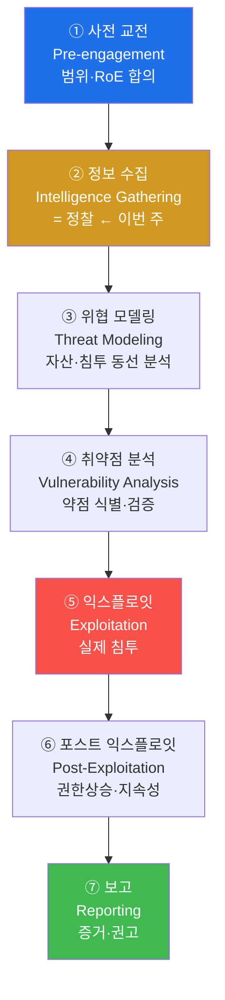
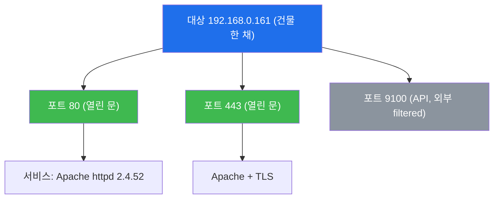
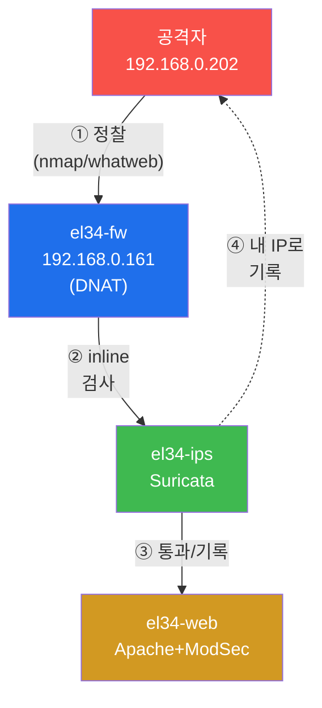
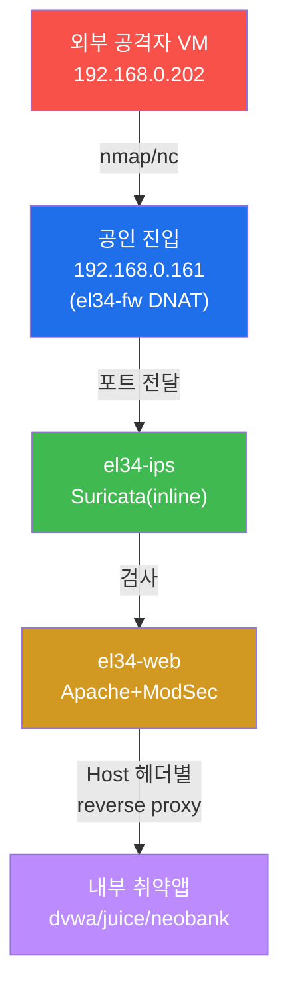

# 공격기법 W01 — 정찰(Reconnaissance) 개시: 네가 보낸 첫 패킷이 이미 공격이다

> **본 주차의 한 줄 요약**
>
> 정찰은 "아무렇지 않은 정보 수집"이 아니라 **이미 전쟁이 시작됐다는 선언**이다.
> `192.168.0.202`(네 외부 공격자 VM)에서 `192.168.0.161`(공인 진입)으로 날아가는
> 첫 SYN 패킷의 순간부터, el34의 방화벽·Suricata·ModSec·Wazuh는 **"누가, 언제,
> 어떤 속도로, 얼마나"** 두드렸는지를 기록한다. 본 주차에서는 네 박스 위에서
> 대상의 포트·서비스·웹 기술 스택을 직접 식별하되, **그 정찰이 방어 스택
> (Suricata `eve.json`)에 네 자신의 IP로 어떻게 남는지** 같은 실습 안에서
> 동시에 추적한다. 좋은 공격자는 첫 패킷을 보내기 전에 "내가 얼마나
> 시끄러운가"를 계산한다. W01은 그 계산을 배우는 주차다.

---

## ⚔ 첫 상황 — 지금 네 자리

네 앞에 두 개 화면이 있다.

- **공격자 화면** — `ssh att@192.168.0.202`(비번 `1`). 이 VM이 진짜 **외부 공격자
  의 자리**다. 도커 컨테이너를 `docker exec`으로 뒤적이는 게 아니라, `nmap`/`nc`/
  `whatweb`을 **네 박스**에서 공인 진입 `192.168.0.161`에 쏘는 방식이다.
- **방어자 화면** — `ssh ccc@10.20.31.2`(비번 `1`). 여기는 el34-ips. Suricata의
  심장부. `tail -f /var/log/suricata/eve.json` 을 걸어 두면, 네가 뭘 보냈는지가
  `src_ip` 필드로 **네 IP 그대로** 흘러 들어온다.

두 화면을 동시에 보며 정찰을 하는 것 — 그게 본 트랙 전체의 방식이다.

## ⚠️ 인가된 환경에서만 — RoE는 공격자의 보험

이 트랙의 모든 명령은 **인가된 실습 환경(el34)** 안에서만 수행한다.
실제 운영 중인 시스템에 대한 무단 포트 스캔은 정보통신망법(정보시스템 무단 접속죄)
으로 처벌되는 범죄다. "정찰은 공격이 아니다"는 신화다 — 정찰조차도 상대 시스템에
패킷을 두드린 **행위**이며, RoE가 있으면 평가이고 없으면 **사건**이다.

| RoE 요소 | 본 트랙에서의 확정 내용 | 어기면 |
|---------|------------------------|--------|
| **범위** | 대상 `192.168.0.161`(공인 진입) + vhost `*.el34.lab` | el34 외 IP로 패킷 전송 |
| **시간** | 현재 강의 시간(24시간 격리 가상 환경) | 운영 시스템으로 확장 |
| **방법** | 제공 명령으로만, DoS 금지 | `nmap -sC`를 `192.168.0.0/24` 전체에 |
| **증거** | 명령 + 방어로그(eve.json) 이중 기록 | 로그 없이 "그냥 못 봤어요" |

---

## 학습 목표 — 이 주차 종료 시 네 손으로

1. PTES 7단계의 순서를 말하고, 정찰이 왜 1단계인지, **정찰을 건너뛰면 어떤 구체적 실패가 다음 단계에서 터지는지**(닫힌 포트에 SQLi, 버전 불일치 익스플로잇, 즉각 차단) 설명한다.
2. **수동(passive) vs 능동(active) 정찰**의 차이를 구분하고, 각 단계가 el34 Suricata에 몇 건의 흔적으로 남는지 비교한다.
3. `nmap -p`로 공개 포트(`80/443/8001-8007` open, `9100` filtered)를 발견하고 `nmap -sV`로 포트 뒤 서비스·버전(Apache httpd 2.4.52)을 식별한다.
4. `whatweb -a1`으로 웹 기술 스택을 핑거프린팅하고, **Host 헤더 한 줄이 dvwa(403)와 juice(200)를 갈라먹는** vhost 분기를 확인한다.
5. 자기 정찰이 `eve.json`에 `src_ip=192.168.0.202`로 탐지되는 것을 직접 읽고, **"EL34 Possible nmap SYN scan 102건"** 이라는 숫자의 의미를 해석한다.
6. 포트·서비스·vhost를 **공격 표면(attack surface)**으로 매핑하고, 방어 가시성까지 담은 1페이지 정찰 보고서로 종합한다.

---

## 0. 용어 해설 (정찰 입문)

| 용어 | 영문 | 뜻 | **공격 맥락 — 이걸 아는 공격자는 무엇을 다르게 하는가** |
|------|------|----|----------------------|
| **침투 테스트** | Penetration Test (pentest) | 인가받아 공격자처럼 약점 찾는 평가 | **의뢰받은 모의도둑** — RoE 안에서만 노린다 |
| **PTES** | Penetration Testing Execution Standard | 침투 테스트 표준 7단계 | **공사 표준 공정표** — 순서 어기면 건물(결과)이 무너짐 |
| **정찰** | Reconnaissance (recon) | 공격 전 대상 정보 수집 | **정찰에 1시간 쓰면 익스플로잇에 10분** — 건너뛰면 10시간 후에도 0.01% |
| **수동 정찰** | Passive recon | 패킷 안 보내고 공개 정보만 수집 | **대상이 모른 채 답사당함** — IDS에 0건 |
| **능동 정찰** | Active recon | 패킷을 보내 응답으로 수집 | **문을 직접 두드림** — el34엔 최소 102건 시그니처로 남음 |
| **RoE** | Rules of Engagement | 범위·시간·방법·증거의 합의 | **모의훈련 안전 수칙** — 실탄 대신 공포탄, 이 구역 밖 금지 |
| **공격 표면** | Attack Surface | 노릴 수 있는 모든 진입점의 총합 | **건물의 모든 문·창문·환기구** — el34: 80/443/8001-8007 + 6 vhost |
| **포트** | Port | 0~65535로 한 IP의 서비스를 구분 | **65535개 문 번호** — 80번 문 뒤 = Apache 2.4.52 |
| **서비스** | Service | 해당 포트에서 응답하는 프로그램 | **문 뒤에서 일하는 사람** — Apache 80/443을 지키고 있음 |
| **핑거프린팅** | Fingerprinting | 응답 특징으로 종류·버전 식별 | **지문으로 신원 확인** — `Server: Apache httpd 2.4.52`가 지문 |
| **nmap** | Network Mapper | 포트 스캔·서비스 식별 표준 도구 | **만능 문 점검기** — 문이 열렸는지, 뒤엔 누가 있는지 |
| **whatweb** | — | 웹 기술 스택 식별 | **간판·내부 안내판 읽기** — "이 매장은 Apache+PHP" |
| **vhost** | Virtual Host | 같은 IP/포트에서 Host 헤더로 사이트 분기 | **한 건물 6 매장** — dvwa/juice/neobank/mediforum/govportal/admin |
| **DNAT** | Destination NAT | 공인 IP 포트를 내부 사설 대상으로 전달 | **대표번호 → 내선** — 192.168.0.161:80 → 10.20.32.80:80 |
| **Suricata** | — | 방어 측 IDS/IPS(시그니처 검사) | **24시간 CCTV + 인덱스 자동 생성** — `eve.json`이 인덱스 |
| **eve.json** | Extensible EVent JSON | Suricata의 패킷 분석 결과 1줄 JSON | **CCTV 인덱스** — `src_ip`=침입자 얼굴 그대로(네 IP) |
| **IDS / IPS** | Intrusion Detection / Prevention System | 침입 탐지 / 탐지+차단 | **CCTV**(IDS) vs **CCTV+자동 잠금**(IPS) — el34 Suricata는 inline(IPS) |
| **CVE** | Common Vulnerabilities and Exposures | 공개 취약점 세계 공통 번호 | **질병 표준 코드** — `Apache 2.4.52`의 "질병 목록" 검색 키 |

### 0.5.1 정찰 — "왜 바로 문을 안 열나"

노련한 도둑은 금고를 털기 전 건물을 며칠 답사한다. 문 몇 개, 경비 교대 시각,
CCTV 사각지대, 잠금장치 — 정보를 모은 뒤에야 빠르고 조용한 침입이 된다.

보안에서는 이것이 **정찰**. 하지만 한 가지를 더 기억하라 — **정찰 그 자체가
이미 공격이다.** "정보 수집 중"인 순간에 방어자는 "이 IP가 두드렸다"는 기록을
시작한다. el34에서 그 두드림은 `EL34 Possible nmap SYN scan` 시그니처 102건으로
남는다. 즉, 정찰 = 정보 수집 **이자** 첫 시그니처 발생.

정찰은 두 갈래다. 차이의 핵심은 **들킬 위험**.

| 도둑 답사 | 정찰 | 대상접촉 | IDS 흔적 |
|-----------|------|----------|---------|
| 멀리서 망원경 + 공개 도면 | **수동(passive)** | 없음(공개 정보만) | **0건** — 대상이 모름 |
| 문고리 직접 흔들기, 창문 두드리기 | **능동(active)** | 직접 패킷 발송 | **수십~수백건** — EL34 Nmap 시그니처 |

- **수동 정찰(passive)** — 대상에 패킷을 보내지 않는다. DNS 등록 정보, 검색엔진
  캐시, GitHub에 새된 파일, Certificate Transparency 로그. 대상은 답사당하는지
  알 수 없다.
- **능동 정찰(active)** — 대상에 패킷을 보내 응답을 분석한다. `nmap`이 대표.
  정보를 훨씬 많이 얻지만 **대상의 방어 스택에 흔적이 남는다.** 본 주차 실습은
  인가된 환경에서의 능동 정찰이다.

> **핵심**: 지금 `nmap`/`whatweb`을 돌리는 것 = 능동 정찰 = el34 Suricata에
> **네 IP로** 남는 일. 좋은 공격자는 "내가 지금 얼마나 시끄러운가"를 항상 계산
> 한다 — 그게 §6 탐지 회피의 출발점이자 W02의 주제다.

### 0.5.2 PTES — "순서를 건너뛰면 무너지는 공정계"

집을 짓는 시공사는 순서를 안 어긴다. 기초가 없는데 골조를 올리면 건물이 무너진다.
침투 테스트의 표준 공정계는 **PTES(Penetration Testing Execution Standard)** —
아래 7단계. 본 주차는 그중 **② 정보수집(정찰)** 이다.



각 단계가 공격자에게 무엇을 주나:

- **① 사전 교전(Pre-engagement)** — 행동 전에 고객과 범위·시간·금지사항을 문서로
  합의한다. 여기서 정해지는 것이 **RoE(§0.5.3)**. 이 합의 없이 패킷을 보내면
  "평가"가 "사건"이 된다.
- **② 정보수집 = 정찰(이번 주)** — 대상의 포트·서비스·기술 스택을 파악한다.
- **③ 위협 모델링** — 정찰 결과를 보고 "어디로 들어갈 수 있는가"를 분석한다.
- **④ 취약점 분석** — 식별한 약점이 실제로 악용 가능한지 검증한다(W03~).
- **⑤ 익스플로잇** — 검증된 취약점으로 실제 침투한다.
- **⑥ 포스트 익스플로잇** — 침투 후 권한상승·지속성 확보·내부 이동(W11~W12).
- **⑦ 보고** — 발견·증거·개선 권고를 문서화한다. 실무에서 가장중요한 산출물.

> **왜 정찰이 ①(②)인가?** 정찰을 건너뛰고 곧장 익스플로잇으로 직행하면,
> 무엇이 열렸는지도 모른 채 아무 포트에나 알려진 공격을 난사한다. 그 결과는
> (a) 성공률 극히 낮음, (b) 방어 스택에 엄청 시끄러운 흔적 → 즉시 차단.
> **충분한 정찰이 곧 성공적이고 조용한 침투의 토대**다.

### 0.5.3 RoE — "모의훈련 안전 수칙"

아무리 실전처럼 훈련해도 안전 수칙이 있다 — "실탄 대신 공포탄, 이 구역 밖
출입 금지, 이 시간 안에만." 침투 테스트의 **RoE(Rules of Engagement, 교전
규칙)** 는 합법과 불법을 가르는 경계선으로, 네 가지를 명시한다.

- **범위(Scope)** — 어떤 IP·도메인까지 공격해도 되는가. 범위 밖은 무단 침입.
- **시간(Timing)** — 언제 공격하나. 업무 시간 외로 제한하는 경우가 많다.
- **방법(Methods)** — 금지 사항. 예: DoS 금지, 실데이터 유출 금지.
- **증거(Evidence)** — 모든 행동을 기록으로 남겨 사고 시 책임 소재를 명확히.

본 트랙의 RoE는 단순하다 — **el34 안에서만, 제공된 명령으로만.** el34 밖의
시스템에는 절대 손대지 않는다.
### 0.5.4 포트와 서비스 — "65535개의 문"

한 IP(`192.168.0.161`)를 큰 건물 한 채로 보면, 0~65535번의 출입문이 있다. 각 문 번호가 **포트(port)**, 문 뒤에서 일하는 사무실(프로그램)이 **서비스**다.

공격자가 포트를 스캔하는 이유는 명확하다 — **열린 문(포트)이 곧 입구 후보**
이고, 문 뒤 서비스의 종류·버전을 알아야 그에 맞는 알려진 약점(CVE)을 찾을
수 있기 때문이다.


### 0.5.5 eve.json — "CCTV 인덱스" (방어 측이 보는 것)

집 CCTV는 24시간 녹화하면서 "몇 시에 무슨 일이 있었나" 인덱스를 자동 생성한다.
방어 측 **Suricata** 의 그 인덱스가 **eve.json** 이다. Suricata는 볼 패킷의
분석 결과를 1패킷 1줄 JSON으로 기록하며, `event_type`(alert/http/dns/flow)
으로 분류된다. 공격자 관점에서 가장 중요한 필드는 `src_ip`(누가 보냈나)와
`alert.signature`(무슨 이름으로 잡혔나)다.

```json
{"timestamp":"2026-06-20T13:01:16+0000","event_type":"alert",
 "src_ip":"192.168.0.202","dest_ip":"10.20.32.80",
 "alert":{"signature":"EL34 Possible nmap SYN scan"}}
```

| eve.json 필드 | CCTV 인덱스 대응 | 공격자에게 주는 의미 |
|---------------|------------------|---------------------|
| `timestamp` | 영상 시각 | 내 행동이 기록된 시점 |
| `src_ip` | 침입자 얼굴 | **내 출처 IP가 그대로 노출** |
| `event_type` | 정상/비정상 구분 | `alert` = 의심 트래픽 |
| `alert.signature` | 무슨 행동이었나 | `EL34 Possible nmap SYN scan` = 내 스캔이 이름 붙여짐 |
> **el34 핵심 사실 — 출처 IP 보존.** el34의 fw는 공격 트래픽
> 을 SNAT(출처 위장)하지 않는다. 따라서 네 공격 VM
> (`192.168.0.202`)의 IP는 Suricata·웹로그·SIEM 전 계층에
> **그대로 보존**된다. 네 정찰이 내 IP로 또렷이 기록된다는 뜻이며,
> 이것이 §5 방어 가시성 실습의 전제다.
## 1. 정찰의 필요성 — 모르는 것은 박살낼 수 없다
정보를 모으기 전에 쏘는 탄은 어딘가에 맞을 지 몰라도,
**자기 위치를 드러내는 것만**은 확실하다.

정찰을 건너뛰면 생기는 실패는 반복된다:

| 정찰을 건너뛴 행동 | 결과 | 정찰했다면 |
|---|---|---|
| 닫힌 포트에 SQLi 시도 | 응답 없음, 시간 낭비 | 열린 80/443만 노렸을 것 |
| 모든 포트에 익스플로잇 난사 | IDS 즉시 탐지·차단 | 표적 한 곳만 조용히 공략 |
| 서비스 버전 모른 채 공격 | 버전 불일치로 실패 | 버전에 맞는 CVE 선택 |

공통 원인은 **정보 부족**이다. 정찰의 충실도가 곧 침투의 성공률이다.

---

## 2. 공방 통합 — 공격을 하면서
 방어의 눈을 켜둔다

el34는 공격자 출처 IP를 fw → ips → web 전 계층에
보존한다(§0.5.5). 본 트랙은 공격기를 훈련하되,
자기 행동이 방어 스택에 어떤 흔적으로 남는지 동시에
 추적한다. **자기 행동이 어떻게
탐지되는지 아는 공격자만 탐지를 회피할 수 있기**
때문이다.



핵심은 ④점선 — 내 정찰 패킷이 IPS에 **내 IP로
기록**되어 돌아온다는 점. §5에서 이 흔적을 직접 확인한다.

---

## 3. el34 정찰 대상 — 토폴로지와 네 위치

### 3.1 공격자는 어디에 서 있는가

네 공격 위치: **외부 공격자 VM `192.168.0.202`(att/1)** — 네 자신의
박스다. 여기에서 대상의 **공인 진입 `192.168.0.161`** 을 친다. fw가 공인
포트를 DNAT로 내부(10.20.32.80)에 전달하므로, 내부 IP를 몰라도 공개
포트만으로 내부 웹에 도달한다. 실제 외부 공격자와 똑같은 위치에 선다.



