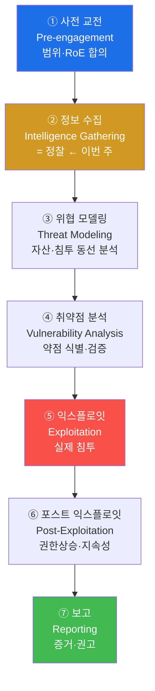
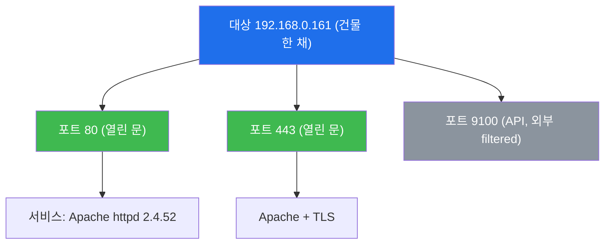
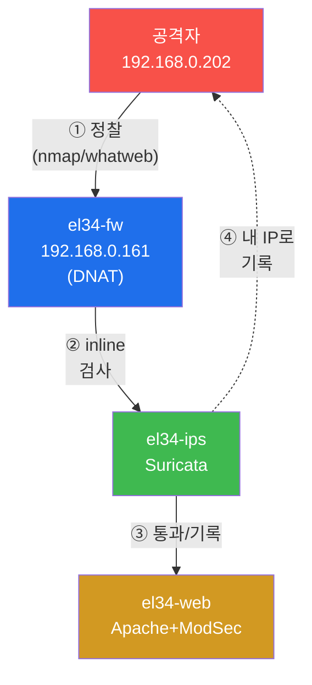
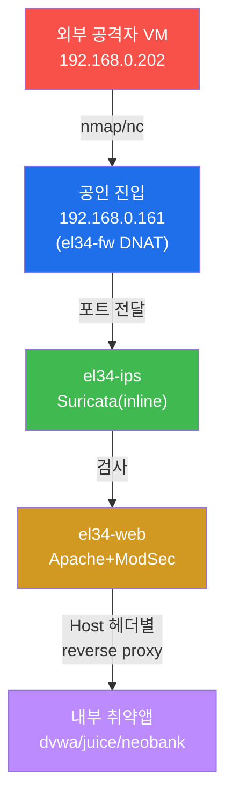
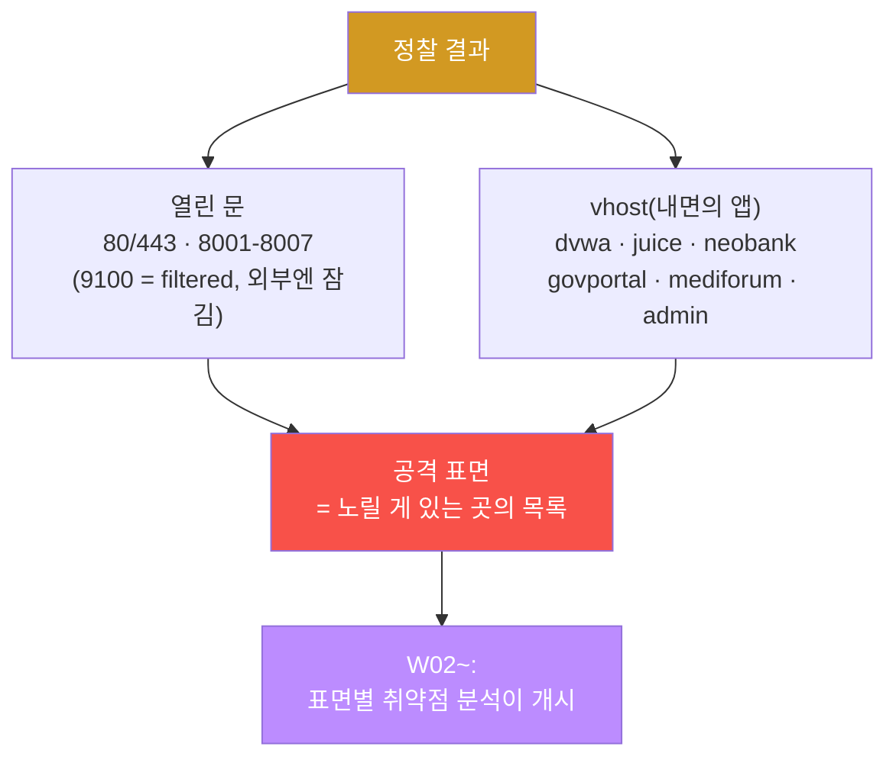
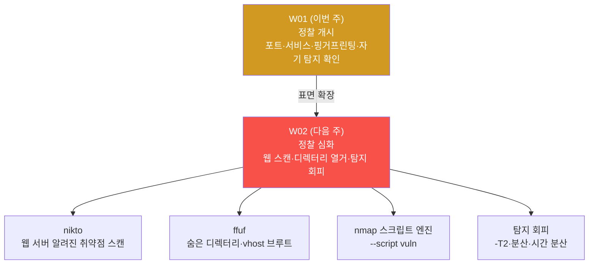

# 공격기법 W01 — 정찰(Reconnaissance) 개시: 네가 보낸 첫 패킷이 이미 공격이다

> **본 주차의 한 줄 요약**
>
> 정찰은 "아무렇지 않은 정보 수집"이 아니라 **이미 전쟁이 시작됐다는 선언**이다.
> `192.168.0.202`(네 외부 공격자 VM)에서 `192.168.0.161`(공인 진입)으로 날아가는
> 첫 SYN 패킷의 순간부터, el34의 방화벽·Suricata·ModSec·Wazuh는 **"누가, 언제,
> 어떤 속도로, 얼마나"** 두드렸는지를 기록한다. 본 주차에서는 네 박스 위에서
> 대상의 포트·서비스·웹 기술 스택을 직접 식별하되, **그 정찰이 방어 스택
> (Suricata `eve.json`)에 네 자신의 IP로 어떻게 남는지** 같은 실습 안에서
> 동시에 추적한다. 좋은 공격자는 첫 패킷을 보내기 전에 "내가 얼마나
> 시끄러운가"를 계산한다. W01은 그 계산을 배우는 주차다.

---

## ⚔ 첫 상황 — 지금 네 자리

네 앞에 두 개 화면이 있다.

- **공격자 화면** — `ssh att@192.168.0.202`(비번 `1`). 이 VM이 진짜 **외부 공격자
  의 자리**다. 도커 컨테이너를 `docker exec`으로 뒤적이는 게 아니라, `nmap`/`nc`/
  `whatweb`을 **네 박스**에서 공인 진입 `192.168.0.161`에 쏘는 방식이다.
- **방어자 화면** — `ssh ccc@10.20.31.2`(비번 `1`). 여기는 el34-ips. Suricata의
  심장부. `tail -f /var/log/suricata/eve.json` 을 걸어 두면, 네가 뭘 보냈는지가
  `src_ip` 필드로 **네 IP 그대로** 흘러 들어온다.

두 화면을 동시에 보며 정찰을 하는 것 — 그게 본 트랙 전체의 방식이다.

## ⚠️ 인가된 환경에서만 — RoE는 공격자의 보험

이 트랙의 모든 명령은 **인가된 실습 환경(el34)** 안에서만 수행한다.
실제 운영 중인 시스템에 대한 무단 포트 스캔은 정보통신망법(정보시스템 무단 접속죄)
으로 처벌되는 범죄다. "정찰은 공격이 아니다"는 신화다 — 정찰조차도 상대 시스템에
패킷을 두드린 **행위**이며, RoE가 있으면 평가이고 없으면 **사건**이다.

| RoE 요소 | 본 트랙에서의 확정 내용 | 어기면 |
|---------|------------------------|--------|
| **범위** | 대상 `192.168.0.161`(공인 진입) + vhost `*.el34.lab` | el34 외 IP로 패킷 전송 |
| **시간** | 현재 강의 시간(24시간 격리 가상 환경) | 운영 시스템으로 확장 |
| **방법** | 제공 명령으로만, DoS 금지 | `nmap -sC`를 `192.168.0.0/24` 전체에 |
| **증거** | 명령 + 방어로그(eve.json) 이중 기록 | 로그 없이 "그냥 못 봤어요" |

---

## 학습 목표 — 이 주차 종료 시 네 손으로

1. PTES 7단계의 순서를 말하고, 정찰이 왜 1단계인지, **정찰을 건너뛰면 어떤 구체적 실패가 다음 단계에서 터지는지**(닫힌 포트에 SQLi, 버전 불일치 익스플로잇, 즉각 차단) 설명한다.
2. **수동(passive) vs 능동(active) 정찰**의 차이를 구분하고, 각 단계가 el34 Suricata에 몇 건의 흔적으로 남는지 비교한다.
3. `nmap -p`로 공개 포트(`80/443/8001-8007` open, `9100` filtered)를 발견하고 `nmap -sV`로 포트 뒤 서비스·버전(Apache httpd 2.4.52)을 식별한다.
4. `whatweb -a1`으로 웹 기술 스택을 핑거프린팅하고, **Host 헤더 한 줄이 dvwa(403)와 juice(200)를 갈라먹는** vhost 분기를 확인한다.
5. 자기 정찰이 `eve.json`에 `src_ip=192.168.0.202`로 탐지되는 것을 직접 읽고, **"EL34 Possible nmap SYN scan 102건"** 이라는 숫자의 의미를 해석한다.
6. 포트·서비스·vhost를 **공격 표면(attack surface)**으로 매핑하고, 방어 가시성까지 담은 1페이지 정찰 보고서로 종합한다.

---

## 0. 용어 해설 (정찰 입문)

| 용어 | 영문 | 뜻 | **공격 맥락 — 이걸 아는 공격자는 무엇을 다르게 하는가** |
|------|------|----|----------------------|
| **침투 테스트** | Penetration Test (pentest) | 인가받아 공격자처럼 약점 찾는 평가 | **의뢰받은 모의도둑** — RoE 안에서만 노린다 |
| **PTES** | Penetration Testing Execution Standard | 침투 테스트 표준 7단계 | **공사 표준 공정표** — 순서 어기면 건물(결과)이 무너짐 |
| **정찰** | Reconnaissance (recon) | 공격 전 대상 정보 수집 | **정찰에 1시간 쓰면 익스플로잇에 10분** — 건너뛰면 10시간 후에도 0.01% |
| **수동 정찰** | Passive recon | 패킷 안 보내고 공개 정보만 수집 | **대상이 모른 채 답사당함** — IDS에 0건 |
| **능동 정찰** | Active recon | 패킷을 보내 응답으로 수집 | **문을 직접 두드림** — el34엔 최소 102건 시그니처로 남음 |
| **RoE** | Rules of Engagement | 범위·시간·방법·증거의 합의 | **모의훈련 안전 수칙** — 실탄 대신 공포탄, 이 구역 밖 금지 |
| **공격 표면** | Attack Surface | 노릴 수 있는 모든 진입점의 총합 | **건물의 모든 문·창문·환기구** — el34: 80/443/8001-8007 + 6 vhost |
| **포트** | Port | 0~65535로 한 IP의 서비스를 구분 | **65535개 문 번호** — 80번 문 뒤 = Apache 2.4.52 |
| **서비스** | Service | 해당 포트에서 응답하는 프로그램 | **문 뒤에서 일하는 사람** — Apache 80/443을 지키고 있음 |
| **핑거프린팅** | Fingerprinting | 응답 특징으로 종류·버전 식별 | **지문으로 신원 확인** — `Server: Apache httpd 2.4.52`가 지문 |
| **nmap** | Network Mapper | 포트 스캔·서비스 식별 표준 도구 | **만능 문 점검기** — 문이 열렸는지, 뒤엔 누가 있는지 |
| **whatweb** | — | 웹 기술 스택 식별 | **간판·내부 안내판 읽기** — "이 매장은 Apache+PHP" |
| **vhost** | Virtual Host | 같은 IP/포트에서 Host 헤더로 사이트 분기 | **한 건물 6 매장** — dvwa/juice/neobank/mediforum/govportal/admin |
| **DNAT** | Destination NAT | 공인 IP 포트를 내부 사설 대상으로 전달 | **대표번호 → 내선** — 192.168.0.161:80 → 10.20.32.80:80 |
| **Suricata** | — | 방어 측 IDS/IPS(시그니처 검사) | **24시간 CCTV + 인덱스 자동 생성** — `eve.json`이 인덱스 |
| **eve.json** | Extensible EVent JSON | Suricata의 패킷 분석 결과 1줄 JSON | **CCTV 인덱스** — `src_ip`=침입자 얼굴 그대로(네 IP) |
| **IDS / IPS** | Intrusion Detection / Prevention System | 침입 탐지 / 탐지+차단 | **CCTV**(IDS) vs **CCTV+자동 잠금**(IPS) — el34 Suricata는 inline(IPS) |
| **CVE** | Common Vulnerabilities and Exposures | 공개 취약점 세계 공통 번호 | **질병 표준 코드** — `Apache 2.4.52`의 "질병 목록" 검색 키 |

### 0.5.1 정찰 — "왜 바로 문을 안 열나"

노련한 도둑은 금고를 털기 전 건물을 며칠 답사한다. 문 몇 개, 경비 교대 시각,
CCTV 사각지대, 잠금장치 — 정보를 모은 뒤에야 빠르고 조용한 침입이 된다.

보안에서는 이것이 **정찰**. 하지만 한 가지를 더 기억하라 — **정찰 그 자체가
이미 공격이다.** "정보 수집 중"인 순간에 방어자는 "이 IP가 두드렸다"는 기록을
시작한다. el34에서 그 두드림은 `EL34 Possible nmap SYN scan` 시그니처 102건으로
남는다. 즉, 정찰 = 정보 수집 **이자** 첫 시그니처 발생.

정찰은 두 갈래다. 차이의 핵심은 **들킬 위험**.

| 도둑 답사 | 정찰 | 대상접촉 | IDS 흔적 |
|-----------|------|----------|---------|
| 멀리서 망원경 + 공개 도면 | **수동(passive)** | 없음(공개 정보만) | **0건** — 대상이 모름 |
| 문고리 직접 흔들기, 창문 두드리기 | **능동(active)** | 직접 패킷 발송 | **수십~수백건** — EL34 Nmap 시그니처 |

- **수동 정찰(passive)** — 대상에 패킷을 보내지 않는다. DNS 등록 정보, 검색엔진
  캐시, GitHub에 새된 파일, Certificate Transparency 로그. 대상은 답사당하는지
  알 수 없다.
- **능동 정찰(active)** — 대상에 패킷을 보내 응답을 분석한다. `nmap`이 대표.
  정보를 훨씬 많이 얻지만 **대상의 방어 스택에 흔적이 남는다.** 본 주차 실습은
  인가된 환경에서의 능동 정찰이다.

> **핵심**: 지금 `nmap`/`whatweb`을 돌리는 것 = 능동 정찰 = el34 Suricata에
> **네 IP로** 남는 일. 좋은 공격자는 "내가 지금 얼마나 시끄러운가"를 항상 계산
> 한다 — 그게 §6 탐지 회피의 출발점이자 W02의 주제다.

### 0.5.2 PTES — "순서를 건너뛰면 무너지는 공정계"

집을 짓는 시공사는 순서를 안 어긴다. 기초가 없는데 골조를 올리면 건물이 무너진다.
침투 테스트의 표준 공정계는 **PTES(Penetration Testing Execution Standard)** —
아래 7단계. 본 주차는 그중 **② 정보수집(정찰)** 이다.



각 단계가 공격자에게 무엇을 주나:

- **① 사전 교전(Pre-engagement)** — 행동 전에 고객과 범위·시간·금지사항을 문서로
  합의한다. 여기서 정해지는 것이 **RoE(§0.5.3)**. 이 합의 없이 패킷을 보내면
  "평가"가 "사건"이 된다.
- **② 정보수집 = 정찰(이번 주)** — 대상의 포트·서비스·기술 스택을 파악한다.
- **③ 위협 모델링** — 정찰 결과를 보고 "어디로 들어갈 수 있는가"를 분석한다.
- **④ 취약점 분석** — 식별한 약점이 실제로 악용 가능한지 검증한다(W03~).
- **⑤ 익스플로잇** — 검증된 취약점으로 실제 침투한다.
- **⑥ 포스트 익스플로잇** — 침투 후 권한상승·지속성 확보·내부 이동(W11~W12).
- **⑦ 보고** — 발견·증거·개선 권고를 문서화한다. 실무에서 가장중요한 산출물.

> **왜 정찰이 ①(②)인가?** 정찰을 건너뛰고 곧장 익스플로잇으로 직행하면,
> 무엇이 열렸는지도 모른 채 아무 포트에나 알려진 공격을 난사한다. 그 결과는
> (a) 성공률 극히 낮음, (b) 방어 스택에 엄청 시끄러운 흔적 → 즉시 차단.
> **충분한 정찰이 곧 성공적이고 조용한 침투의 토대**다.

### 0.5.3 RoE — "모의훈련 안전 수칙"

아무리 실전처럼 훈련해도 안전 수칙이 있다 — "실탄 대신 공포탄, 이 구역 밖
출입 금지, 이 시간 안에만." 침투 테스트의 **RoE(Rules of Engagement, 교전
규칙)** 는 합법과 불법을 가르는 경계선으로, 네 가지를 명시한다.

- **범위(Scope)** — 어떤 IP·도메인까지 공격해도 되는가. 범위 밖은 무단 침입.
- **시간(Timing)** — 언제 공격하나. 업무 시간 외로 제한하는 경우가 많다.
- **방법(Methods)** — 금지 사항. 예: DoS 금지, 실데이터 유출 금지.
- **증거(Evidence)** — 모든 행동을 기록으로 남겨 사고 시 책임 소재를 명확히.

본 트랙의 RoE는 단순하다 — **el34 안에서만, 제공된 명령으로만.** el34 밖의
시스템에는 절대 손대지 않는다.
### 0.5.4 포트와 서비스 — "65535개의 문"

한 IP(`192.168.0.161`)를 큰 건물 한 채로 보면, 0~65535번의 출입문이 있다. 각 문 번호가 **포트(port)**, 문 뒤에서 일하는 사무실(프로그램)이 **서비스**다.

공격자가 포트를 스캔하는 이유는 명확하다 — **열린 문(포트)이 곧 입구 후보**
이고, 문 뒤 서비스의 종류·버전을 알아야 그에 맞는 알려진 약점(CVE)을 찾을
수 있기 때문이다.


### 0.5.5 eve.json — "CCTV 인덱스" (방어 측이 보는 것)

집 CCTV는 24시간 녹화하면서 "몇 시에 무슨 일이 있었나" 인덱스를 자동 생성한다.
방어 측 **Suricata** 의 그 인덱스가 **eve.json** 이다. Suricata는 볼 패킷의
분석 결과를 1패킷 1줄 JSON으로 기록하며, `event_type`(alert/http/dns/flow)
으로 분류된다. 공격자 관점에서 가장 중요한 필드는 `src_ip`(누가 보냈나)와
`alert.signature`(무슨 이름으로 잡혔나)다.

```json
{"timestamp":"2026-06-20T13:01:16+0000","event_type":"alert",
 "src_ip":"192.168.0.202","dest_ip":"10.20.32.80",
 "alert":{"signature":"EL34 Possible nmap SYN scan"}}
```

| eve.json 필드 | CCTV 인덱스 대응 | 공격자에게 주는 의미 |
|---------------|------------------|---------------------|
| `timestamp` | 영상 시각 | 내 행동이 기록된 시점 |
| `src_ip` | 침입자 얼굴 | **내 출처 IP가 그대로 노출** |
| `event_type` | 정상/비정상 구분 | `alert` = 의심 트래픽 |
| `alert.signature` | 무슨 행동이었나 | `EL34 Possible nmap SYN scan` = 내 스캔이 이름 붙여짐 |
> **el34 핵심 사실 — 출처 IP 보존.** el34의 fw는 공격 트래픽
> 을 SNAT(출처 위장)하지 않는다. 따라서 네 공격 VM
> (`192.168.0.202`)의 IP는 Suricata·웹로그·SIEM 전 계층에
> **그대로 보존**된다. 네 정찰이 내 IP로 또렷이 기록된다는 뜻이며,
> 이것이 §5 방어 가시성 실습의 전제다.
## 1. 정찰의 필요성 — 모르는 것은 박살낼 수 없다
정보를 모으기 전에 쏘는 탄은 어딘가에 맞을 지 몰라도,
**자기 위치를 드러내는 것만**은 확실하다.

정찰을 건너뛰면 생기는 실패는 반복된다:

| 정찰을 건너뛴 행동 | 결과 | 정찰했다면 |
|---|---|---|
| 닫힌 포트에 SQLi 시도 | 응답 없음, 시간 낭비 | 열린 80/443만 노렸을 것 |
| 모든 포트에 익스플로잇 난사 | IDS 즉시 탐지·차단 | 표적 한 곳만 조용히 공략 |
| 서비스 버전 모른 채 공격 | 버전 불일치로 실패 | 버전에 맞는 CVE 선택 |

공통 원인은 **정보 부족**이다. 정찰의 충실도가 곧 침투의 성공률이다.

---

## 2. 공방 통합 — 공격을 하면서
 방어의 눈을 켜둔다

el34는 공격자 출처 IP를 fw → ips → web 전 계층에
보존한다(§0.5.5). 본 트랙은 공격기를 훈련하되,
자기 행동이 방어 스택에 어떤 흔적으로 남는지 동시에
 추적한다. **자기 행동이 어떻게
탐지되는지 아는 공격자만 탐지를 회피할 수 있기**
때문이다.



핵심은 ④점선 — 내 정찰 패킷이 IPS에 **내 IP로
기록**되어 돌아온다는 점. §5에서 이 흔적을 직접 확인한다.

---

## 3. el34 정찰 대상 — 토폴로지와 네 위치

### 3.1 공격자는 어디에 서 있는가

네 공격 위치: **외부 공격자 VM `192.168.0.202`(att/1)** — 네 자신의
박스다. 여기에서 대상의 **공인 진입 `192.168.0.161`** 을 친다. fw가 공인
포트를 DNAT로 내부(10.20.32.80)에 전달하므로, 내부 IP를 몰라도 공개
포트만으로 내부 웹에 도달한다. 실제 외부 공격자와 똑같은 위치에 선다.



### 3.2 정찰의 두 표면 — 문은 한 개, 문 뒤의 사람은 여섯 명

nmap은 **건물**을 보여준다. 여긴 어떤 **사람**이 사는지까지는 보여주지 않는다. el34의 표면을
두 층위로 나눠 봐라.

| 표면 | 뭘 묻는가 | 도구 | el34에서 나오는 답 |
|------|-----------|------|--------------------|
| **포트(L3/L4)** | 어떤 문이 열려 있나 | `nmap -p` | 80/443/8001-8007 open, 9100 filtered |
| **vhost(L7)** | 그 문 뒤에 어떤 앱이 서 있나 | `whatweb -a1 http://dvwa.el34.lab/` | 같은 80번 문 뒤: dvwa·juice·neobank... |

> **vhost(Virtual Host) 한 줄로**: 같은 IP·포트에서 응답하는
> 사이트가 **`Host:` 헤더의 도메인 이름에 따라 갈리는** 방식이다. 한 건물 주소, 여섯
> 개의 간판. el34의 web 컨테이너(Apache)는 `Host: dvwa.el34.lab`를 보면 dvwa로, `Host: juice.el34.lab`를 보면 juice로
> 리버스 프록시한다. 즉 **80번 포트 하나가 여섯 개의 표면을 품고 있다.**


el34의 vhost 목록 — 포트 스캔으로 절대 안 보이고, Host 헤더에 맞춰가며 열어야만 드러나는 명함들:

| vhost (Host 헤더) | 내면의 앱 | 표면에 기대는 취약점 성격 |
|-------------------|-----------|--------------------------|
| `dvwa.el34.lab` | DVWA | SQLi / XSS / 명령주입 — 난이도 4단계를 지르는 학습용 취약점 |
| `juice.el34.lab` | OWASP Juice Shop | 모던 SPA — 80개 넘는 챌린지에 매몰된 취약점 |
| `neobank.el34.lab` | NeoBank | 인증 + **IDOR(권한 우회)** — 내 청구서가 네 청구서 |
| `govportal.el34.lab` | GovPortal | 인증 + **LFI(로컬 파일 포함)** — 서버의 파일시스템을 골라 읽게 하는 문 |
| `mediforum.el34.lab` | MediForum | XSS 중심 |
| `admin.el34.lab` | AdminConsole | **RCE / XXE** — 관리자 콘솔. 여기가 열려 있으면 반쯤 임 |

vhost가 열거되려면 **열거하러 간 사람**이 있어야 한다. nmap은 여권만 찍고 간다. 간판을
읽는 건 네 몫이다. 이것이 W01 실습 4와 실습 6이 dvwa/juice 두 개를 직접 때리는 이유다 —
그리고 "운영자가 깜빡여 숨긴 vhost가 곧 가장 약한 고리"라는 W02의
디렉터리·vhost 브루트(ffuf)가 곧 등장하는 이유이기도 하다.

### 3.3 실습의 접근 모델 — 어디서 명령을 보내는가

이 트랙에서 공격은 **네 VM에서 나가는 패킷**이다. `192.168.0.202`(att/1)에 SSH로
들어와 `nmap`이든 `whatweb`이든 거기서 쏘고, 방어를 보려면 `10.20.31.2`(IPS)에
SSH해서 `eve.json`을 열어본다. 한 명령이 두 화면에 나눠 찍히는 그 순간 — "나를
보고 있다"는 감각이 데이터로 전환된다.

```bash
# 공격자 화면 — 도구는 여기서만 실행된다
ssh att@192.168.0.202        # 비밀번호: 1
nmap --version

# 방어자 화면 — IPS 장비에 직접 접속, Suricata 심장을 열어봄
ssh ccc@10.20.31.2           # 비밀번호: 1
tail /var/log/suricata/eve.json
```

> **자연 URL이 왜 중요한가.** 공격 VM의 `/etc/hosts`에 `192.168.0.161 dvwa.el34.lab juice.el34.lab ...`
> 가 이미 등록되어 있다. `http://dvwa.el34.lab/`로 whatweb이 보내는 각 요청이
> **Host 헤더를 붙인 채** 해당 vhost로 갈린다. 생 IP + `-H "Host: ..."`를 매번 손으로
> 조합할 필요가 없다 — 그런데 이 "필요 없음" 자체가 vhost가 Host 헤더로 갈린다는 증거다.

### 3.4 도구를 직접 꾸리는 법 — 이번 주 참고, 이후 각 주차에서 반복

공격 VM엔 이미 깔려 있다: `nmap`(포트·서비스), `nc`(raw TCP/HTTP), `nikto`(웹 취약점 스캔),
`whatweb`(기술 스택), `ffuf`·`gobuster`(디렉터리 브루트), `sqlmap`(SQLi 자동화),
`dalfox`(XSS 자동화), `python3-scapy`(패킷 크래프팅). 본 주차의 무기는 `nmap`과 `whatweb`
두 가지 — 나머지는 각 주차가 자기 차례에 꺼낸다.

실무에서 박스는 **스스로** 꾸린다. Debian/Ubuntu 계열 기준, 한 번만 써두면 끝:

```bash
# 1) 배포판 패키지로 한 번에
sudo apt-get update
sudo apt-get install -y nmap nikto whatweb netcat-openbsd gobuster sqlmap python3-scapy

# 2) Go 도구 — 배포판에 없으면 go install 또는 GitHub 릴리스 바이너리
sudo apt-get install -y ffuf      # 없으면: go install github.com/ffuf/ffuf/v2@latest
go install github.com/hahwul/dalfox/v2@latest

# 3) 확인 — 경로가 나오면 곧 준비 완료
which nmap nikto whatweb ffuf gobuster sqlmap dalfox
```


---

## 4. 정찰 도구 — 네 손에 쥐여줄 두 개

### 4.1 nmap — 문을 두드리고, 안에서 누가 있는지 들음

한 줄: **열린 문을 발견하고, 문 뒤에 앉아 있는 사람의 이름·버전까지 읽는 기계.**

```bash
nmap -sV -p 80,443,8001-8007,9100 192.168.0.161 -T4 --max-retries 1
```

- `-p 80,443,8001-8007,9100` — **두드릴 문 번호를 지정**. el34 fw가 DNAT한 공개 포트다.
  지정하지 않으면 nmap이 기본 1000개 문을 두드린다.
- `-sV` — **문 뒤에 누가 서 있나**까지 읽게 한다. "열림/닫힘"에서 한 단계 더,
  `Apache 2.4.52`인지 `nginx`인지까지. 이 버전 문자열이 곧 CVE 검색의 키워드다.
- `-T4` — 속도 템플릿 4(aggressive). T0(paranoid)~T5(insane) 6단계 중 4.
  **빠를수록 시끄럽다.** 탐지 위험이 직접 비례한다.
- `--max-retries 1` — 응답 없는 문에 재시도 1회로 제한. 스캔 시간을 깎는다.

실제로 el34가 내는 출력(핵심 줄만):

```
PORT     STATE    SERVICE  VERSION
80/tcp   open     http     Apache httpd 2.4.52
443/tcp  open     ssl/http Apache httpd 2.4.52
8001/tcp open     ...      ...
9100/tcp filtered
```

- `open` — **문 열림.** 바로 노려볼 수 있는 입구.
- `filtered` — 방화벽조차 응답을 삼킨 문. el34의 9100은 fw가 DNAT해 놓았으나
  **외부 공격자 시점엔 도달 안 됨**. "DNAT돼 있다" ≠ "열려 있다".
- `Apache httpd 2.4.52` — 이 문자열이 CVE 데이터베이스에서의 검색 키다.
  `2.4.52`에 알려진 약점이 있는지 검색하러 가는 것이 W02의 개시 지점.

**한계**: `-sV`는 능동 정찰. Suricata가 널 이미 보고 있다. §5에서 그대로 확인한다.

### 4.2 whatweb + nc — 간판 읽기, 그리고 원시 응답 읽기

한 줄: nmap이 "80번 문에 가게 있다"까지 말해주면, whatweb은
**"그 가게 메뉴판에 Apache+PHP, jQuery 3.x 적혀 있다"**까지 말해주며, `nc`는
**매장에서 직접 전단지를 받아서 눈으로 읽는** 짓이다.

```bash
whatweb -a1 http://dvwa.el34.lab/
```

- `-a1` — 공격성(능동성) 레벨 1, **최소 침입**. 서버가 돌려준 응답만으로 판단.
  추가 탐침을 억눌러 로그를 덜 남긴다. -a3 이상의 능동 probes는 WAF에 잡힌다.
- `http://dvwa.el34.lab/` — 자연 URL. Host 헤더가 자동 붙는다. **이 URL의 도메인
  부분만 바꿔 보내면**(juice.el34.lab 등) **vhost를 열거**하는 셈이 된다.

whatweb이 내는 핵심 단서:

```
dvwa.el34.lab [200] Apache:,Cookies,PHP,jQuery
```

- `Apache:` — 웹 서버 존재.
- `PHP` — 백엔드 ngôn어. `PHPSESSID` 쿠키가 그 증거다.
- `jQuery` — 프론트 프레임워크.
- `[200]` — **정상 응답**. 403이면 WAF가 먹었거나 vhost 분기 실패.
  **dvwa는 일부 환경에서 403을, juice는 200을 준다.** 이 차이가 곧
  "WAF가 두 vhost를 다르게 취급하고 있다"는 증거가 되며, W03에서 본격적으로
  갈라진다.

`nc`로 원시 응답을 직접 읽는 법(같은 일을 raw로):

```bash
printf 'GET / HTTP/1.1\r\nHost: dvwa.el34.lab\r\n\r\n' | nc 192.168.0.161 80 | head -20
```

응답의 첫 줄과 `Server:` 헤더, `Set-Cookie:`이 보인다. whatweb이 이걸 자동화한
거다 — **왜** 자동으로 읽히는지 알기 위해 raw로 한 번은 직접 봐야 한다.

**한계**: 운영자가 `ServerTokens Prod`로 헤더를 숨기면 어떤 버전도 안 보인다.
whatweb도 능동 정찰이라 웹 접근 로그에 남는다.


---

## 5. 방어 가시성 — 방금 보낸 **네** 스캔이 CCTV에 어떻게 남았나

공격 과목에서 방어 로그를 보는 이유는 한 가지다: **네 행동의 지문 모양을 아는 것.**
어떤 행동이 어떤 시그니처로 붙잡히는지, 그것이 누적되면 방어자가 뭘 하는지 —
이걸 모르면 W02 이후의 "탐지 회피"는 추측일 뿐이다.

**Suricata** — el34-ips 컨테이너에서 inline(IPS)로 지나가는 모든 트래픽을
시그니처로 검사하는 기계. 탐지 결과를 `eve.json`에 1줄 JSON으로 쓴다 (§0.5.5).

방금 보낸 정찰이 **네 IP(192.168.0.202)**로 몇 건이나 남았는지 — IPS 장비에서:

```bash
ssh ccc@10.20.31.2 'tail -2000 /var/log/suricata/eve.json | jq -rc "select(.event_type==\"alert\" and .src_ip==\"192.168.0.202\")|.src_ip" | sort | uniq -c'

ssh ccc@10.20.31.2 'tail -2000 /var/log/suricata/eve.json | jq -rc "select(.event_type==\"alert\" and .src_ip==\"192.168.0.202\")|.alert.signature" | sort | uniq -c | tail -3'
```

명령 분해:

- `tail -2000 /var/log/suricata/eve.json` — 최근 2000줄. alert는 flow에 비해
  드문 이벤트라 깊게 파야 잡힌다.
- `jq ... select(.event_type=="alert" and .src_ip=="192.168.0.202")` —
  alert이면서 **출처가 네 IP**인 것만 골라냄. `.src_ip`가 **네 얼굴**이다.
- `.alert.signature` — 그 alert가 **무슨 이름**의 공격으로 붙잡혔는지 뽑음.
- `sort | uniq -c` — 같은 이름을 묶어 **몇 건**이 쌓였는지 세기.

내가 실제로 el34에서 보기는(네가 보게 될 숫자는 스캔 규모에 따라 달라진다):

```
  102 192.168.0.202
     8 ET SCAN Nmap Scripting Engine
    12 EL34 Possible nmap SYN scan
```

읽는 법:

- `102`건 — **네** 포트 스캔이 102건의 alert로 번역되었다. 실전이었다면
  1분도 안 돼 `iptables -A INPUT -s 192.168.0.202 -j DROP`.
- `ET SCAN Nmap Scripting Engine` — nmap의 `-sV`(스크립트 엔진) 발자국.
- `EL34 Possible nmap SYN scan` — el34 특유의 시그니처. **네 SYN 플러드가
  nmap의 것**으로 분류되었다는 뜻.

> **완전히 안 잡히는 능동 정찰은 없다.** 줄이는 법은 — (a) 느린 스캔
> (`-T2`/`-T1`)로 빈도 임계치를 파고, (b) 한 IP에서 몰빵하지 않고 분산하며,
> (c) 두드릴 문을 최소한으로 줄인다. W02가 이 세 개를 훈련하는 주차다.
> 그리고 (d) 도저히 패킷을 보내야 안 되는 케이스는 **수동 정찰**로
> (§0.5.1) — 대상에 패킷 하나도 안 보내는 정찰이다.
---

## 6. 공격 표면 매핑 — 정찰이 무장으로 바뀌는 지점

정찰의 산출물은 결과물이 아니라 **무기 목록**이다. 흩어진 관찰(포트, vhost,
엔드포인트)을 "여기서 뭘 노릴 수 있나"라고 재배치한 것이 **공격 표면
(attack surface)** — 건물의 모든 문·창문·환기구 목록이다.



표면 옆에 **예상 취약점 태그**를 붙이는 습관이 바로 PTES ③ 위협 모델링·
④ 취약점 분석의 입력이다:

| 진입점 | 예상 태그 | 근거 |
|--------|-----------|------|
| `dvwa.el34.lab` | SQLi / XSS / 명령주입 | DVWA의 존재 목적 |
| `juice.el34.lab` | 80+ 챌린지(다종) | Juice Shop의 존재 목적 |
| `neobank.el34.lab` | **IDOR** | 은행 = "내 청구서가 네 청구서" 문제 |
| `govportal.el34.lab` | LFI(파일 포함) | 문서 시스템 |
| `admin.el34.lab` | RCE / XXE | 관리자 콘솔 — 열리면 반쯤 임 |


---

## 7. 실습 안내 (총 8 미션)

각 미션은 4축으로 읽는다 — **(a) 왜** **(b) 무엇을 알 수 있나** **(c) 출력이 나와서
무엇이 보이는가** **(d) 실전에서 이 한 수를 쓸 때**. 모든 명령은 el34 호스트에서
`ssh att@192.168.0.202` 로 수행하며, 인가된 대상(192.168.0.161) 한정이다.

### Red-01 점검 — 내 무기가 있는지, 대상이 살아 있는지가

**(a) 왜.** 정찰의 0번째 단계. 도구가 없거나 대상에 못 닿으면 그 뒤 전부 공회전이다.

**(b) 무엇을 알 수 있나.** `nmap`/`whatweb`/`sqlmap`의 경로(=설치 확인)와,
공인 진입 192.168.0.161이 dvwa vhost로 응답하는지(도달성).

**(c) 출력.** `which`가 세 경로를 뽑고, whatweb이 `dvwa.el34.lab`의 기술 스택 한 줄을
뿌리면 패스. 응답 코드 `000`이면 패킷이 안 닿는 것.

**(d) 실전.** 모든 침투의 첫 명령. 이걸 건너뛰면 실패 원인(내 환경인가, 대상인가)을
분리 못한다.

```bash
# 공격 VM(192.168.0.202)에서 실행:
# 1) 정찰 도구(nmap/whatweb/sqlmap) 설치 경로 확인 — 경로 나오면 설치됨
ssh att@192.168.0.202 'which nmap whatweb sqlmap'
# 2) 대상(공인 진입 192.168.0.161) 도달성 + 지문 — whatweb(dvwa vhost로 분기)
ssh att@192.168.0.202 'whatweb -a1 http://dvwa.el34.lab/'
```

### Red-02 문 열기 — 어떤 포트가 열려 있나

**(a) 왜.** 열린 문이 곧 입구. 포트 스캔은 공격 표면의 1층이다.

**(b) 무엇을 알 수 있나.** 80/443/8001-8007/9100 중 `open`인 것 — el34의
외부 노출 표면 전체.

**(c) 출력.** `open` 줄이 80/443/8001~8007을 나열하고, `9100`이
`filtered`로 남아 있다면 — DNAT되어도 외부엔 잠긴 문임을 실측한 것이다.

**(d) 실전.** 자산 점검 1순위. 의외로 열린 관리 포트가 곧 침투 경로다.
반대로 el34 9100처럼 "DNAT되어 있어도" 외부엔 잠긴 포트도 있음을
구분하는 습관.

```bash
# 공격 VM(192.168.0.202)에서 실행:
ssh att@192.168.0.202 'nmap -p 80,443,8001-8007,9100 192.168.0.161 -T4 --max-retries 1 2>/dev/null | grep -E "open|PORT"'
```

### Red-03 문 뒤의 사람 — 서비스·버전 식별

**(a) 왜.** "열려 있다"만으론 못 쏜다. 뒤에 누가 서 있는지 알면 노릴 게 있다.

**(b) 무엇을 알 수 있나.** 80/443 뒤가 `Apache httpd 2.4.52`인지. 이 버전
자체가 CVE 검색 키워드다.

**(c) 출력.** `VERSION` 열에 `Apache httpd` 줄이 보이면 식별 성공.
버전 숫자까지 잡힌 것이 좋은 스캔이다.

**(d) 실전.** PTES ④ 취약점 분석의 개시점. `2.4.52`로 CVE DB를 여는 일이다.

```bash
# 공격 VM(192.168.0.202)에서 실행:
ssh att@192.168.0.202 'nmap -sV -p 80,443 192.168.0.161 -T4 --max-retries 1 2>/dev/null | grep -E "open|PORT|http"'
```

### Red-04 간판 열거 — vhost 뒤의 다른 가게

**(a) 왜.** 같은 80번 문 뒤에도 앱은 하나만 없다. Host 헤더를 바꿔가며
**간판을 열거**해야 표면이 완성된다.

**(b) 무엇을 알 수 있나.** dvwa와 juice의 응답이 어떻게 다른지 —
그 "다름"이 곧 WAF가 두 vhost를 다르게 취급한다는 증거(W03의 씨앗).

**(c) 출력.** 각 vhost의 기술 스택 한 줄. 응답 코드가 같으면 같은 취급,
달라면(403 vs 200) **WAF 정책의 경계선**을 본 것이다.

**(d) 실전.** 잊힌 vhost(관리자 콘솔 등)가 가장 약한 고리인 경우가 많다 —
W02의 ffuf vhost 브루트가 바로 이 문을 여는 도구다.

```bash
# 공격 VM(192.168.0.202)에서 실행:
ssh att@192.168.0.202 'whatweb -a1 http://dvwa.el34.lab/'
ssh att@192.168.0.202 'whatweb -a1 http://juice.el34.lab/'
```


### Red-05 CCTV 열기 — 방금, 내가 몇 건에 찍혔나

**(a) 왜.** 좋은 공격자는 **자신의** 지문 모양을 안다. 나 자신을 모르는
공격자는 방어자에게 배울 수 없다.

**(b) 무엇을 알 수 있나.** 방금 보낸 정찰(포트 스캔 + whatweb)이
`src_ip=192.168.0.202`(= **내 IP**)로 몇 건의 alert가 되었는지,
그리고 **무슨 이름**의 시그니처로 분류되었는지.

**(c) 출력.** 두 숫자가 나란히: (1) **몇 건**인가(100+이면 "매우 시끄러운
스캔"), (2) **무슨 이름으로** 묶였는지(`Nmap`, `SCAN`...).
출력이 **비어 있다면** — 아직 스캔을 안 보낸 것이다. Red-02/03을 먼저.

**(d) 실전.** 레드팀의 자가 점검. "오늘 나의 IP가 방어측 alert 몇 건
만들었나"가 탐지 회피 설계의 기준값이다.

```bash
# 방어자 시선(IPS 장비 10.20.31.2)에서 실행:
# 1) eve.json에서 alert+내 출발지(192.168.0.202)만 골라 출발지 집계(내 정찰 탐지 확인)
ssh ccc@10.20.31.2 'tail -2000 /var/log/suricata/eve.json | jq -rc "select(.event_type==\"alert\" and .src_ip==\"192.168.0.202\")|.src_ip" | sort | uniq -c'
# 2) 내 스캔이 무슨 시그니처로 탐지됐는지(예: Nmap/SCAN)
ssh ccc@10.20.31.2 'tail -2000 /var/log/suricata/eve.json | jq -rc "select(.event_type==\"alert\" and .src_ip==\"192.168.0.202\")|.alert.signature" | sort | uniq -c | tail -3'
# 3) 해석 — 내 스캔이 출발지 192.168.0.202로 탐지됨, 회피는 느린(-T2)/분산 스캔(고급)
```

### Red-06 표면 그리기 — 정찰이 무장으로

**(a) 왜.** 결과가 흩어지면 아무도 못 쏜다. 포트·스택·vhost를
**하나의 목록**으로 통합하는 순간 정찰은 무기가 된다.

**(b) 무엇을 알 수 있나.** 공개 포트, 웹 vhost, 그리고 그 각각에
**무슨 취약점 후보**가 기대지는지. 이것이 다음 주차(취약점 분석)의 입력이다.

**(c) 출력.** 리스트가 한 줄. "80/443 open"이라는 사실보다
"dvwa=SQLi 후보, neobank=IDOR 후보"라는 문장이 산출물이다.

**(d) 실전.** 이 표가 **PTES ③ 위협 모델링 + ④ 취약점 분석**의 문서로
직접 들어간다.

```bash
# 공격 VM(192.168.0.202)에서 실행:
echo "공개 포트(open): 80/443(HTTP/S), 8001-8007(앱 포트). 9100(API)은 외부 attacker(192.168.0.202)엔 filtered(미도달)"
echo "웹 vhost: dvwa.el34.lab(SQLi/XSS), juice.el34.lab(modern), neobank/mediforum/govportal..."
```

### Red-07 PTES + RoE — 순서와 경계

**(a) 왜.** 명령을 외우는 것보다 중요한 것은 "왜 이 순서인가"와
"어디까지가 합법인가"를 **내 말로** 갖는 것이다.

**(b) 무엇을 알 수 있나.** PTES 6단계의 순서(본 주차가 ① 정찰에 해당)
그리고 RoE 4요소(범위·시간·방법·증거).

**(c) 출력.** 본인 말로 6단계와 4요소를 말할 수 있으면 합격.
도구보다 중요한 **방법론의 소유**다.

**(d) 실전.** 실무 침투 테스트는 RoE 합의서(PDF, 서명)부터 시작한다.
RoE 밖의 패킷은 **범위 외** = 무단 = **정보통신망법**으로 사건이다.

```bash
# 공격 VM(192.168.0.202)에서 실행:
echo "PTES 6단계: ① 정찰(Intelligence Gathering) ← 이번 주 ② 위협모델링 ③ 취약점분석 ④ 익스플로잇 ⑤ 포스트익스플로잇 ⑥ 보고"
echo "RoE 4요소: 범위(어디까지)·시간(언제)·방법(무엇 금지)·증거(기록). 인가된 대상(192.168.0.161)만, 무단 공격 불법"
```

### Red-08 보고서 — "찾았다"가 아니라 "다음은 이것"

**(a) 왜.** PTES ⑥가 보고다. 아무리 많이 찾아도 **전달하지** 못하면
가치가 없다. 정찰을 1페이지의 보고로 압축하는 훈련.

**(b) 무엇을 알 수 있나.** 도달성·포트·스택·vhost·방어 가시성 —
이 4개 묶음을 **보고서**로 쓰는 형식.

**(c) 출력.** `~/w01_recon_report.md`에 4개 섹션이 채워져 있고
`cat`으로 다시 뽑혀 보이는 것. 이 파일 자체가 산출물이다.

**(d) 실전.** 실무 보고서 축소판: 발견 + 증거(출력 일부분) + 다음 단계
권고. W02 이후 모든 보고서가 이 형식 위에 쌓인다.

```bash
# (편집기로 작성한 보고서 — 채점용: 파일에 기록 후 표시. 학생은 nano 로 직접 작성)
ssh att@192.168.0.202 'cat > ~/w01_recon_report.md <<'"'"'EOF'"'"'
# 공격 W01 정찰 보고서
## 0. 위치: 외부 공격자 VM 192.168.0.202 → 대상 공인 진입 192.168.0.161
## 1. 도달성/포트: 80/443/8001-8007 open (공인 진입 공개 포트)
## 2. 서비스/스택: Apache(HTTP), vhost별 앱(dvwa/juice...)
## 3. 공격 표면: 웹 vhost 다수 = SQLi/XSS/API 익스플로잇 후보
## 4. 방어 가시성: 내 스캔이 Suricata에 출발지 192.168.0.202로 탐지 → 회피 고려(느린/분산 스캔)
## 결론: 정찰로 공격 표면을 매핑. 다음 단계는 표면별 취약점 분석·익스플로잇
EOF
cat ~/w01_recon_report.md'
```


---

## 8. 다음 주차 (W02) 예고 — 문을 열다: 웹 스캔·디렉터리 브루트·조용한 발

W01은 **문을 찾아내고** **CCTV에 몇 건 찍혔나** 세는 주차였다. W02는 그 문을
**노크해서 열어본다**:



구체적으로: (a) `nikto`로 Apache 2.4.52의 알려진 약점을 자동으로 스너, (b)
`ffuf`로 W01에서 못 본 **숨은 vhost·디렉터리·파일**을 열거한다 — 6개 vhost가
정말 6개인지는 W02에 답한다, (c) `nmap --script vuln`으로 버전 기반 취약점을
자동 매핑하고, (d) Red-05에서 본 그 100+건의 alert를 **10건 미만**으로 줄이는
스캔을 만든다.

> **W01 한 방:** 너는 이미 **102건의 alert로** 방금 이 방을 검색했다 —
> 그리고 **그 사실**을 스스로의 눈으로 확인했다. 이것이 공격자의 시작이다:
> **공격은 문을 열기 이전, 첫 패킷에서 시작된다.**

